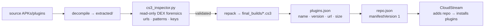

# 🍒 cs3-velvet — CloudStream plugin repository

**20 CS3 plugins, repacked from validated DEX.** Add one URL to CloudStream and install them all.

[](https://github.com/toxicwind/cs3-velvet)
[](#plugins)
[](#install)

## Install

1. Open CloudStream → **Settings → Extensions → Add repository**
2. Paste:

   ```
   https://raw.githubusercontent.com/toxicwind/cs3-velvet/main/repo.json
   ```

3. CloudStream reads `repo.json`, follows it to `plugins.json`, and offers every plugin below for one-tap install. Updates land automatically when the manifests change.

## Plugins

19 validated builds ship in `final_builds/` — each repacked from a DEX that passed forensic inspection. `Universal Morphe` lives in `builds/` and is **not validated**; install it only if you know what you're doing.

| Plugin | Ver | Lang | Build |
|---|---|---|---|
| GayStream | 2 | en | ✅ validated |
| GayKinkyPorn | 1 | en | ✅ validated |
| Xhamster | 1 | vi | ✅ validated |
| Nurgay | 2 | en | ✅ validated |
| topHDgayporn | 2 | en | ✅ validated |
| iGay69 | 3 | en | ✅ validated |
| Gaycock4U | 2 | en | ✅ validated |
| GXtapes | 3 | en | ✅ validated |
| Justthegays | 2 | en | ✅ validated |
| GEPorner | 2 | en | ✅ validated |
| XvideosGay | 1 | en | ✅ validated |
| Jayboys | 1 | en | ✅ validated |
| GPornOne | 1 | vi | ✅ validated |
| Fullboys | 4 | vi | ✅ validated |
| Gaypornvidsxxx | 3 | en | ✅ validated |
| Gayxx | 2 | en | ✅ validated |
| Fxggxt | 3 | en | ✅ validated |
| BestHDgayporn | 2 | en | ✅ validated |
| BoyfriendTV | 1 | en | ✅ validated |
| Universal Morphe | 1 | en | ⚠️ unvalidated |

## What's here

| Path | Role |
|---|---|
| `repo.json` | Repository manifest — the URL you add to CloudStream; points at `plugins.json` |
| `plugins.json` | Plugin list: name, version, language, authors, tvTypes, download URL, file size |
| `final_builds/` | 19 validated `.cs3` plugins (the shippable artifacts) |
| `builds/` | Intermediate builds, including the unvalidated `universal.cs3` |
| `extracted/` | Decompiled plugin sources (analysis only — never installed) |
| `cs3_inspector.py` | Read-only forensic DEX inspector (stdlib only) |
| `EXTRACTION_REPORT.md` | Full decompilation & extraction report (2026-05-25): per-plugin URL hits, regex patterns, extracted keys |
| `AGENTS.md` | Repo conventions for agents working here |

The pipeline, end to end:



Each `plugins.json` entry carries: `name`, `internalName`, `description`, `iconUrl`, `apiVersion`, `url` (the `.cs3` download), `fileSize`, `version`, `language`, `authors`, `tvTypes`, `status`, `repositoryUrl`.

## Verify it yourself

Inspect a plugin without installing anything:

```bash
python3 cs3_inspector.py final_builds/GayStream.cs3
```

Every `.cs3` is a ZIP containing `classes.dex`. The inspector only reads — it never executes plugin code.

## Security

- Treat any `.cs3` from outside `final_builds/` as untrusted until it passes the same inspection pipeline.
- `extracted/` sources are decompiled for analysis; they are not install artifacts.

## License

MIT where marked.
